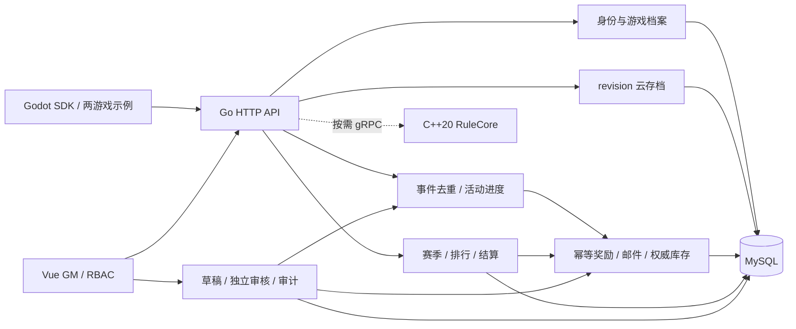

# MVP 架构与数据流程

Godot SDK → HTTP API → 按职责划分的 Go 模块 → MySQL。GM 网页通过同一个 API 的管理路由操作。所有玩家业务操作同时验证会话、game_id 与玩家身份；管理操作验证角色、授权游戏和原因。

数据库迁移是独立进程；API 的 /health 仅检查进程，/ready 使用数据库 Ping 和迁移版本检查。请求使用服务端生成的 ID，结构化日志不记录请求正文、密码或令牌。退出时停止接受请求，最多等待十秒。

活动消费事件时，在同一个事务内保存去重记录和进度；奖励使用稳定业务键，邮件领取与库存入账同一事务。云存档的版本比较在数据库锁内执行，旧 revision 返回冲突。游戏间不能共享道具或余额。

普通业务由 Go 单体处理。C++ RuleCore 只对明确要求的回放做确定性校验，超时和非法回放均拒绝计入可信成绩。AI 输出必须经过结构校验、业务校验和模拟，再由有权限的人员审核发布。

每个里程碑的实际实现状态与验证结论见 verification/RESULTS.md；本文描述目标架构，不作为已实现证明。

## 当前实现

见 ADR-0001 与 api.md。按 game_id 作用域的关系表持久化身份档案、存档历史、事件、进度、发奖流水、邮件、库存、榜单、申请和审计；独立 migration_files 记录校验和。渠道测试凭证与真实身份分离，mock 计划不直接发布，C++ 失败只影响按需回放校验。

