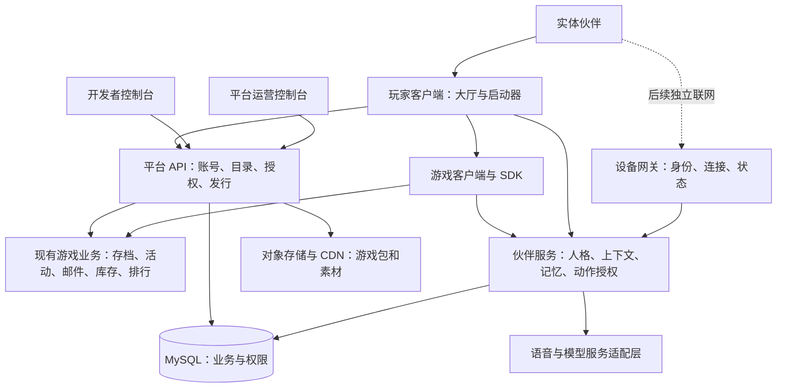

# MiniVerse 游戏平台与实体 AI 伙伴方案 V1

日期：2026-11-14。性质：基于当前仓库的产品与技术建议，本文新增内容尚未实现。

## 1. 产品定位

打造一个面向广大玩家的多游戏平台：玩家登录平台，发现并进入不同游戏；拥有一个持续陪伴自己的 AI 伙伴，它能以适合各游戏的 NPC 形象出现，也能通过实体硬件说话、显示表情并回应玩家。

平台由三个端和一组公共服务组成：

| 组成 | 使用者 | 核心职责 |
| --- | --- | --- |
| 玩家平台 | 玩家 | 登录、发现游戏、下载安装、启动、继续游玩、管理 AI 伙伴与设备 |
| 开发者后台 | 游戏开发者/工作室 | 创建项目、接 SDK、提交版本、配置伙伴能力、运营游戏、查看本项目数据 |
| 实体伙伴 | 玩家 | 语音、表情、按键/触摸互动，与游戏里的伙伴延续同一身份 |
| 平台运营控制台 | 平台内部人员 | 开发者与内容审核、版本发布审批、平台推荐、安全与客服处理 |
| 公共服务 | 各端调用 | 身份、目录/发行、游戏业务、AI 伙伴、设备连接和观测 |

开发者后台和平台内部运营控制台应有不同角色、授权和操作入口。开发者只能管理获授权组织及项目，不能通过更换 game_id 访问其他团队数据。

产品灵感可归纳为：多游戏入口、持续身份、跨世界角色、现实陪伴。首版重点验证“玩家是否愿意带着同一个伙伴继续玩另一款游戏”，而非同时建设大型社区、创作引擎和硬件量产体系。

## 2. 当前项目能复用什么

当前项目已是多游戏业务底座，并非只有一个管理页面；但尚未形成面向玩家的游戏平台。

| 现有能力 | 可复用方式 | 待补内容 |
| --- | --- | --- |
| Go + MySQL，多游戏作用域 | 保留账号、游戏档案及业务服务 | 正式平台账号、游戏限定的授权会话、开发者组织隔离 |
| 云存档、版本冲突、本地导入 | 继续支持已有纯客户端游戏渐进接入 | 玩家平台里的云同步状态和恢复入口 |
| 活动、邮件、库存、榜单、审计 | 作为开发者可启用的公共能力 | 面向开发者的申请、接入说明、生产环境凭证和配额 |
| Godot SDK 和示例 | 首批接入及 AI 扩展入口 | 平台登录交接、伙伴接口、上下文和工具协议 |
| GM Web/Tauri | 复用部分管理组件与运营模块 | 开发者控制台信息架构、组织权限、游戏提交与发行管理 |
| 基础游戏列表 | 复用游戏标识 | 封面、详情、分类、发布状态、版本、包体和启动入口 |
| sandbox 渠道登录、mock 策划 | 继续用于测试 | 正式账号验证；不能直接当作生产渠道或真实 AI 服务 |

当前没有可交付的玩家大厅、通用游戏发行器、AI 伙伴服务、硬件配对或同步协议。现有两款游戏是接入示例，首版仍需要两段有实际可玩性的内容。

## 3. 玩家体验

建议首版采用 Windows 玩家客户端，优先适配已有 Godot/独立客户端游戏。它是本方案的工程起点；若目标用户主要在手机，应在界面开发前把首发平台改为 Android，并重新验证包体分发、进程交接、语音和设备连接。保留 H5 作为后续接入类型。

### 3.1 一条完整的体验链

1. 玩家登录，创建或认领一个原创伙伴，为它命名并选择外观。
2. 进入首页：能看到“继续玩”、游戏列表，以及伙伴推荐的一款游戏；推荐必须基于可解释的偏好和游玩记录，首版可采用规则推荐。
3. 打开详情页，查看玩法、兼容设备和 AI 伙伴支持程度，点击安装/启动。
4. 进入游戏 A，伙伴成为该世界的跟随角色或通讯助手，能解释当前目标、给出分级提示，并回应关键事件。
5. 完成一次探险后，游戏提交经过允许的摘要。伙伴可以记得“我们一起修好了第一座桥”，而不是把整个存档和所有对话永久保存。
6. 回到大厅，切换游戏 B；伙伴保留称呼、人格和允许共享的共同经历，在 B 中换成符合世界设定的角色和能力。
7. 配对硬件后，玩家可以选择由硬件发声、游戏显示表情。退出游戏后，硬件仍能聊共同经历；对游戏内道具、任务和排名的操作必须回到对应游戏授权流程。

### 3.2 玩家客户端首版页面

| 页面 | 首版内容 |
| --- | --- |
| 登录与账号 | 正式账号登录、恢复、登出、基本设备会话管理 |
| 首页 | 继续玩、精选游戏、伙伴入口 |
| 游戏库/详情 | 搜索、分类、收藏、安装/更新/启动状态、伙伴支持等级 |
| 我的伙伴 | 名称、外观、共同经历、可查看和删除的记忆、语音设置 |
| 我的设备 | 配对、在线状态、输出位置、解绑和重置说明 |
| 个人中心 | 存档同步、通知、权限与隐私设置 |

即使玩家没有硬件，也能完整使用平台和屏幕内伙伴；硬件提供更强的实体陪伴。玩家不应因硬件掉线而退出游戏。

## 4. 同一伙伴怎样跨游戏

平台为每名玩家的伙伴分配稳定的 companion_id。各游戏中的 NPC 是它在该世界里的化身；不是把所有游戏中原有的 NPC 都合并成同一角色。

| 信息层 | 示例 | 共享规则 |
| --- | --- | --- |
| 平台身份与人格 | 伙伴 ID、玩家给它的名字、说话风格、基础声音 | 平台统一管理，游戏不得擅自覆盖 |
| 玩家授权的关系记忆 | 喜欢慢速探索、偏好较少提示、共同完成的重要冒险 | 经筛选和授权跨游戏使用，可查看、删除和关闭 |
| 世界内角色 | A 中的机械精灵、B 中的战术助手、角色外观/动作映射 | 按 game_id 和内容版本隔离 |
| 游戏状态与事实 | 当前任务、可见对象、剧情进度、允许知道的秘密 | 来自当前游戏，设有效期和版本；离开后不继续当作当前状态 |
| 经济与权益 | 金币、装备、战绩、付费权益 | 保留在对应权威业务，AI 和硬件不能直接修改 |
| 硬件表现 | 表情、发声位置、灯光、连接状态 | 同步展示指令，不作为任务完成或发奖证明 |

对剧情原住民 NPC，可以保留独立身份和局部记忆；只有游戏声明的“伙伴化身”才映射平台 companion_id。这样既保留跨游戏陪伴感，也不会破坏每个世界的叙事。

离线客户端提交的经历可作为低信任的陪伴素材，但不能据此授予稀有外观、排行奖励或其他贵重权益。伙伴成长中应区分“共同经历展示”和“服务端确认的成就”。

## 5. 游戏里的 AI 具体能做什么

### 5.1 接入等级

| 等级 | 能力 | 所需接入 |
| --- | --- | --- |
| 基础 | 介绍游戏、回答已发布攻略、语音聊天 | 游戏资料和已审核知识库；不能声称知道实时游戏状态 |
| 感知 | 知道当前关卡/任务、回应事件、按进度避免剧透 | 游戏通过 SDK 提供结构化上下文和允许上报的事件 |
| 互动 | 跟随、指路、指向场景对象、触发已允许的互动 | 游戏注册动作白名单并返回执行结果 |

首版两款自有游戏做到感知等级，并各选 2–3 个互动动作。外部开发者可以逐级接入；没有 SDK 合作的游戏不能保证跨游戏 NPC 能力。

### 5.2 协议建议

游戏向平台声明一个带版本的 Companion Manifest：伙伴形象、可读状态、事件 schema、动作参数、知识库版本、剧透策略和授权范围。只有平台已审核发布的版本可用于生产环境。

最小 SDK：

```text
connect_companion(game_session)
set_context(scene_id, quest_stage, visible_targets, revision)
emit_event(event_id, type, payload, trust_level)
register_action(name, parameter_schema, handler)
request_hint(level)
leave_game()
```

动作示例为 request_follow、point_to_visible_target、open_help_panel。AI 只提出结构化动作，平台检查会话和权限，游戏检查状态与规则，再返回执行回执。不得开放任意代码、任意 SQL、通用控制台或直接发奖接口。

提示采用“轻提示→明确方向→答案”的递进方式；玩家可控制主动提示频率。助手的主动行为应由玩法事件和触发规则约束，避免持续打断。

## 6. 实体硬件方案

### 6.1 首版形态

建议先做可放在桌面、可带走的小型伙伴：显示表情的屏幕、麦克风、扬声器、实体交互键、静音控制和联网能力。第一版采用按键说话，先验证端到端交互，再决定唤醒词、触摸和更多动作。镜头、移动底盘和复杂机械动作不进入首版。

ESP32-S3 类开发板可作为联网、音频前端和表情终端候选。官方 ESP-SR 提供唤醒、语音活动检测、降噪、回声消除等组件，但这不等于板端具备完整大模型能力；实际内存、音频链路与固件能力需要原型验证。

### 6.2 硬件职责

- 设备端：按键/触摸、音频采集和播放、表情、基础离线反馈、连接状态。
- 云端或玩家主机：对话推理、知识检索、长期记忆、动作规划。
- 游戏端：场景角色、动画和游戏内动作执行。

第一阶段硬件通过玩家客户端转发消息，降低配网和云端设备管理复杂度。第二阶段再支持硬件独立联网；届时才可在玩家主机关闭后继续云端对话。两种连接路线不能同时重复建立同一语音会话。

### 6.3 同步行为

| 玩家操作 | 游戏中的伙伴 | 硬件中的伙伴 |
| --- | --- | --- |
| 正在听玩家说话 | 显示聆听表情 | 显示收音状态 |
| 开始回答 | 播放匹配表情/字幕 | 按玩家选择发声；避免游戏和硬件重复播放 |
| 完成重要事件 | 播放已定义庆祝动作 | 同步简短表情或声音 |
| 切换游戏 | 离开旧世界、进入新化身 | 保持身份，切换允许的世界表现 |
| 硬件掉线 | 游戏正常继续 | 显示离线；重连拉取最新状态 |
| 无网络 | 本地伙伴保留基础互动 | 说明离线，仅提供预置反馈，不伪装成在线理解 |

音频由专用实时链路传输，状态和表情通过独立事件通道传输，不依赖逐帧同步。事件包含 event_id、session_id、context_epoch、sequence 和过期时间；切游戏递增上下文代次，旧动作和旧语音会话及时取消。表情重连后拉快照，过期命令不补放；游戏动作必须幂等，不能因网络重试多次领取或执行。

设备有独立身份和密钥；扫码/配对码只是绑定入口，完成所有权验证后才建立玩家绑定。设备令牌仅能访问该伙伴的受限能力，不能当作玩家平台 token 使用。支持解绑、失窃吊销、恢复出厂和签名固件更新。

## 7. 开发者后台与接入流程

现有 GM 应演进为开发者控制台中的“运营”模块。增加组织、成员角色和项目权限；平台运营审批保留在单独的内部权限域。

开发者流程：创建组织/项目 → 选择接入类型 → 获取测试环境配置 → 接统一登录和可选业务 SDK → 配置伙伴 Manifest/知识库 → 上传包体与素材 → 自动检查和人工审核 → 灰度发布 → 看数据/处理反馈 → 更新或回滚。

| 模块 | 主要内容 |
| --- | --- |
| 组织与项目 | 成员、角色、游戏授权、审计、测试/生产环境分离 |
| 游戏资料 | 封面、介绍、分类、兼容平台、伙伴支持等级 |
| 构建与发布 | 版本、包体、校验、测试、审批、灰度和回滚 |
| SDK 接入 | 接入文档、调试工具、客户端应用配置、仅服务端使用的密钥管理 |
| 伙伴配置 | 化身映射、上下文字段、可调用动作、知识库、剧透规则、对话测试 |
| 运营 | 现有活动、邮件、库存、榜单、公告、审批和审计 |
| 数据 | 安装与启动成功率、活跃/留存、崩溃、伙伴使用率、AI 延迟与费用 |

游戏客户端不携带开发者服务端密钥。按组织、游戏、玩家和设备限制配额。未审核的 Manifest、工具和新包体不能覆盖已发布版本。

## 8. 技术架构



### 8.1 复用与拆分

继续使用 Go 模块化单体承担普通平台和游戏业务；新建独立玩家客户端工程，开发者后台逐步扩展，不把 GM 界面改名直接交给玩家。

AI/音频的长连接与慢推理采用独立进程或工作队列，避免占用普通 API 和数据库事务。接口通过服务适配层屏蔽模型供应商差异。首版记忆摘要可存 MySQL 并按权限检索，只有数据规模和效果需要时再增加向量检索。实时连接在单实例原型验证后，再依据多实例路由和状态需要引入 Redis 等设施。

原生客户端可评估 Vue + Tauri 作为大厅/启动器，复用现有技术经验，但需要新增受限的下载、安装、启动和本地 IPC 能力。Windows 包体优先采用已审核完整包与原子替换，后续再做差量更新。发行清单需签名并验证文件哈希，下载后检查平台/版本/入口、路径穿越和解压路径，不能允许远端任意命令启动。

### 8.2 授权与上下文

平台长期会话仅保存在平台安全存储中。启动游戏时签发一次性、短时效且绑定游戏与交接校验信息的启动凭证，由游戏交换出 game_id 限定的短期会话；游戏不能拿它访问其他游戏或开发者管理接口。凭证不通过普通 URL、日志或可复用命令行参数泄露。现有按 player_id + game_id 的数据隔离继续保留，但还需对新票据强制执行 game_id 和 scope 限制。

首版同一玩家只设一个前台伙伴互动会话，其他端是其表现端。切游戏或切账号撤销旧上下文；硬件重新配对不能继承前账号的记忆。设备拥有的是连接身份，不是玩家账号的所有权。

### 8.3 数据实体建议

新增：developer_orgs、org_members、game_listings、game_builds、release_channels、player_library、launch_grants、game_sessions、companions、companion_world_roles、companion_memories、companion_sessions、devices、device_bindings、device_events。

已有 games、profiles 和游戏业务表继续使用。核心索引围绕 org_id、player_id、game_id、companion_id、session_id 建立；记忆和设备访问必须从当前会话推导所有者，不能只凭请求中的 ID 查询。

### 8.4 首版服务接口分组

```text
玩家平台：目录/详情、收藏/最近玩、启动凭证、构建清单
开发者：组织/项目、构建提交、发布申请、伙伴 Manifest 与测试
伙伴：创建/配置、当前会话、结构化上下文、事件、对话、动作回执
记忆：查看、允许共享范围、删除、关闭保存
设备：配对挑战、绑定、设备会话、状态快照、解绑/吊销
```

## 9. 首版范围与推进顺序

### P0：把核心体验做出来

两款自有/已授权游戏 + 简单玩家大厅 + 软件伙伴 + 硬件模拟器。先证明同一伙伴从 A 进入 B 后仍能延续关系，又不会混淆两个世界；每个游戏提供一小段完整玩法和 2–3 个可控互动。此时不做广泛开发者招募。

### P1：形成可用的平台闭环

正式账号、目录详情、安装更新和启动交接；两游戏 SDK 接入；开发者控制台支持组织/项目、版本提交与发布；上线伙伴权限、知识库和记忆控制。

### P2：连接真实硬件并做封闭测试

先用现成开发板做按键说话、表情和声音，测配对、断线、切游戏、双端发声与延迟。采用少量真实玩家测试，对照普通屏幕助手，观察跨游戏回访和硬件使用。硬件独立联网、外壳与量产在体验和成本得到验证后推进。

### P3：扩大内容供给

向少数外部开发者开放 SDK、调试器和发布流程，验证独立团队能否完成接入。之后再按需求考虑社区、好友、创作者激励、创作工具和更丰富硬件。Roblox 式统一创作/运行时属于独立的大工程，不是增加游戏列表或账号接口就能获得。

排期应在首发设备、两款游戏完成度和团队配置确定后估算；以上是依赖顺序，不是交付日期承诺。

## 10. 验收标准与经营指标

| 目标 | 验证方法 |
| --- | --- |
| 一次登录玩两款游戏 | 完整走完安装/启动/返回/切换；确认游戏 B 不能读取 A 的存档或经济数据 |
| 伙伴像同一个角色 | 让玩家复述共同经历、称呼和风格；比较切游戏前后感受，不能只检查 companion_id 相同 |
| 不混淆世界 | 预置两游戏冲突设定、不同剧情阶段，验证回答不把 A 的事实当成 B 当前事实 |
| 动作可控 | 未授权动作、旧会话动作、重复请求和伪造发奖均被拒绝 |
| 记忆可控 | 查看/删除/关闭后不再检索；清理副本、检索索引并说明日志与备份保留边界 |
| 硬件同步可靠 | 掉线、重连、切账号、切游戏不补放过期操作、不重复发声、不串号 |
| 开发者隔离 | 项目成员不能越权查看其他组织的包体、玩家数据、密钥和伙伴记忆 |
| 延迟可接受 | 原型目标：结束说话到开始回复的 P95 不超过 2.5 秒；目标需按真实网络、模型和音频测试修订 |

经营指标以跨游戏转化、7 日留存、伙伴主动使用率、单次会话帮助率、硬件周活和退货/闲置原因衡量；不要只看对话次数。AI 需同时记录有效语音分钟、模型/检索/合成消耗和单活跃用户成本。

此前约 4,501 QPS 的本地观测仅是特定档案读取的短时结果，不能用于推算 AI 并发、语音容量或正式平台容量。举例：1,000 在线玩家中若同时有 10% 发起语音，即需要验证 100 条并发语音链路；还应独立压测事件、设备连接、推理排队和发布下载。游戏包走 CDN，游戏帧不持续写入数据库，AI 调用采用按需触发及配额。

## 11. 首版必须落实的边界

- 面向未成年人时，需明确目标年龄、监护授权、语音与记忆处理、消费边界，并在正式发布前按目标市场核验要求。默认采用按键收音和可见的工作状态，提供物理静音；原始录音是否保存必须明确，不能默认无限保留。
- 游戏资料、攻略和玩家输入都可能夹带恶意指令，不能覆盖平台权限；模型生成结果不得直接驱动资产修改或固件操作。
- 对话生成故障时保留普通游戏和基础助手；不因 AI 超时阻断存档和核心玩法。不要用“模型觉得已完成”作为任务或付费凭据。
- 同一角色跨游戏需要有统一设定和各游戏适配规则；使用原创伙伴名称和形象，把参考作品用于体验启发。
- 硬件绑定、固件更新、维修换机、模型费用和客服都属于产品闭环，不能只做一个能聊天的开发板演示就视为可量产。

## 12. 第一轮开发建议

从“玩家大厅 → 一次登录 → 游戏 A → 伙伴互动 → 返回大厅 → 游戏 B 延续伙伴 → 硬件模拟同步”的垂直样例开始。先把这条体验做完整，再扩展开发者接入和真实硬件。现有后端沿用并扩展，现有纯客户端游戏继续渐进接入；玩家平台和伙伴协议是下一阶段的主干工作。

参考资料：

- [当前项目架构](architecture.md)、[纯客户端接入](client-only-integration.md)、[接口说明](api.md)。
- [乐鑫 ESP-SR 音频前端](https://docs.espressif.com/projects/esp-sr/en/latest/esp32s3/audio_front_end/README.html)：硬件候选的音频处理能力，以原型实测为准。
- [Roblox 客户端与服务端安全边界](https://create.roblox.com/docs/scripting/security/client-server-boundary)：客户端输入需由服务端验证；本文采用同样的信任边界原则，并不假定可直接复用其平台能力。
